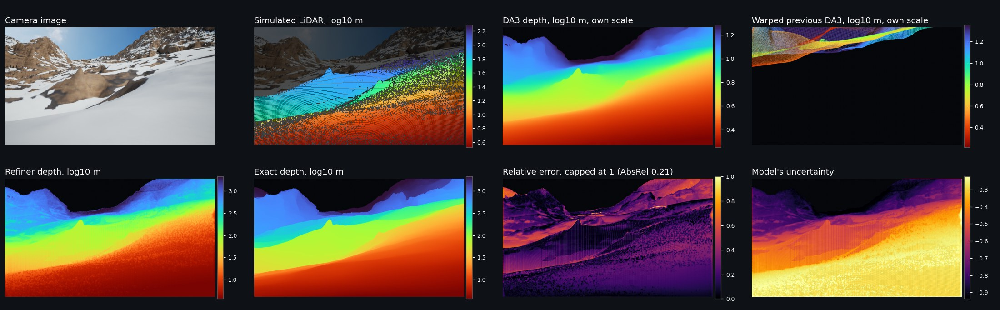
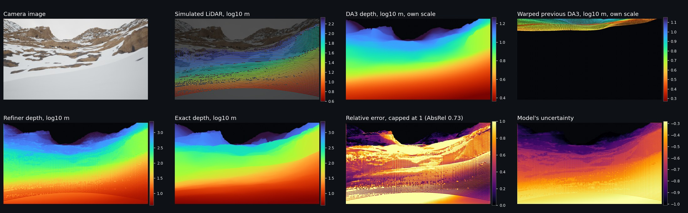
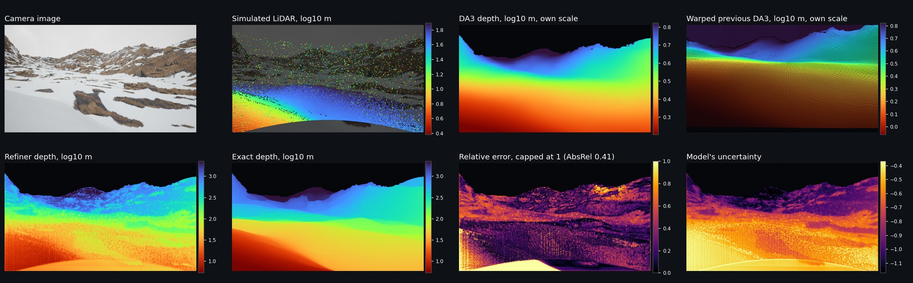
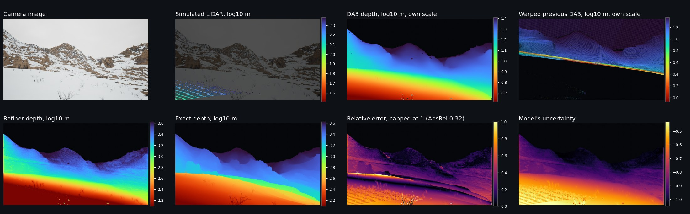
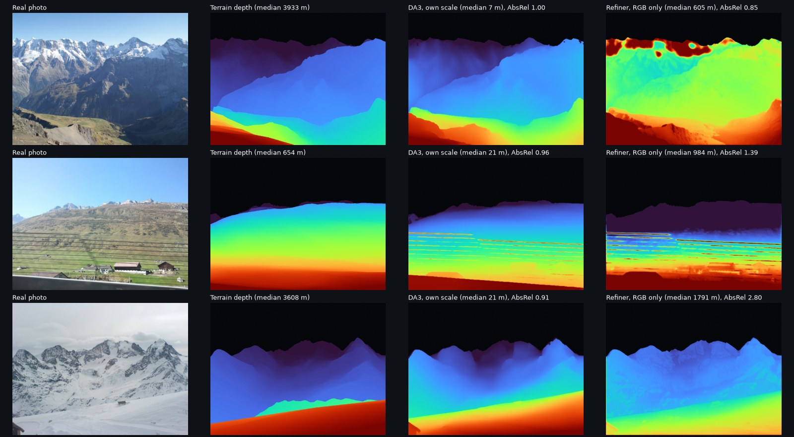
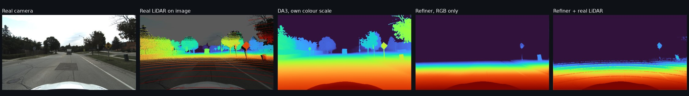
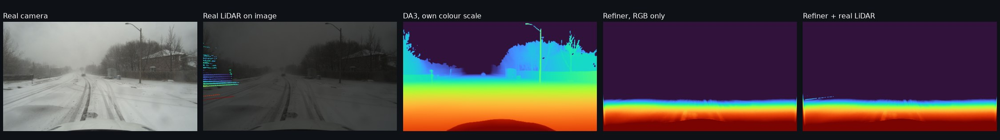

# Alpine snow depth estimation

**Status:** the dataset is rendered and a first refiner is trained. It beats Depth Anything 3 on rendered validation frames and fixes its scale on real mountain photos, but it's still inaccurate on real images and fails on real roads. The test split hasn't been used.

**Paper:** [snow_depth_research_paper.pdf](snow_depth_research_paper.pdf)

**Dataset:** [Ab1231/alpine-snow-depth](https://huggingface.co/datasets/Ab1231/alpine-snow-depth) on Hugging Face

Depth models have very little to work with in snow and flat light, and real depth labels are hard to get because LiDAR picks up snowflakes. I rendered alpine snow scenes in Unreal Engine 5, where the depth is exact, and my plan is to train a small model on them that corrects the depth from a frozen Depth Anything 3.

## The plan

| Part | What it is |
|---|---|
| Dataset (done) | 1,556 images in 778 pairs on real terrain around the Eiger, in sun, flat light and snowfall. Each has exact depth and pose. |
| Sensor simulators (done) | Python scripts that turn exact depth into LiDAR and exact poses into noisy GPS/IMU. The snow noise is measured from 30 real Boreas scans in heavy snow, so it's only a first calibration. |
| Refiner | CNN encoder, transformer bottleneck and CNN decoder on 8 input channels. Takes DA3Metric-Large depth, LiDAR, a warped previous depth and RGB, then outputs corrected depth and a confidence map. |
| Evaluation | Five hypotheses written down before any training, tested on held-out renders and on real snow driving scenes from DENSE and Boreas. |

LiDAR and motion are randomly switched off during training, so one model can run with whatever sensors are available.

## Depth Anything 3 on the renders

I ran frozen DA3Metric-Large on the 1,426 train and validation frames and left the test split unscored. These are plain averages over frames, with sky left out.

| Group | AbsRel | Order | Spread | Overlap |
|---|---:|---:|---:|---:|
| Overall | 0.962 | 0.951 | 0.402 | 0.518 |
| Sun | 0.961 | 0.979 | 0.487 | 0.587 |
| Flat light | 0.962 | 0.946 | 0.392 | 0.512 |
| Snowfall | 0.963 | 0.918 | 0.291 | 0.425 |
| High views | 0.999 | 0.933 | 0.401 | 0.550 |
| Ground views | 0.906 | 0.979 | 0.404 | 0.471 |
| Perfect score | 0 | 1 | 1 | 1 |

AbsRel scores real distance. Order is the Spearman correlation with the exact depth, so it shows whether DA3 knows what's near and far. Spread is the ratio of the two standard deviations of log depth, and overlap compares their histograms after removing the overall scale.

DA3 gets the order right but the metres wrong: the median pixel reads about 0.001 of its true distance, and even within 100 m it reads 0.177 of it. Spread also drops from 0.487 in sun to 0.291 in snowfall, so snow flattens its depth. A single scale correction won't fix that, which leaves the refiner real work to do.

## First refiner results

These come from 12 epochs on 1,246 training frames, with an RTX 3080 at batch size 2. The last 6 epochs added real AbsRel to the paper's loss, because the paper's loss alone left overshoot on nearby pixels. That's a change from the paper, and it still needs updating. Scores are on the 180 validation frames, so they're slightly optimistic. I chose the loss with them, and the test split hasn't been used.

| Score | DA3 alone | Refiner | Perfect |
|---|---:|---:|---:|
| AbsRel | 0.977 | 0.562 | 0 |
| Log error | 6.022 | 0.460 | 0 |
| δ1, pixels within 25% | 0.002 | 0.341 | 1 |
| Near and far order | 0.954 | 0.940 | 1 |
| Typical distance vs true | 0.001x | 0.941x | 1x |

The refiner beats DA3's mean AbsRel on 168 of 180 frames. Near and far order is the one score where DA3 stays ahead. These numbers are better than DA3's, but they're still weak for a depth model: only about a third of pixels are within 25% of the true distance.

| Group | Frames | AbsRel | δ1 | Order |
|---|---:|---:|---:|---:|
| Sun | 78 | 0.441 | 0.395 | 0.961 |
| Flat light | 58 | 0.753 | 0.330 | 0.932 |
| Snowfall | 44 | 0.525 | 0.261 | 0.913 |
| High views | 92 | 0.355 | 0.355 | 0.919 |
| Ground views | 88 | 0.779 | 0.327 | 0.961 |

I also tested the same weights with sensors switched off. LiDAR here is simulated, so its gain only holds in simulation.

| Sensors | AbsRel | Log error | δ1 |
|---|---:|---:|---:|
| All | 0.562 | 0.460 | 0.341 |
| No motion | 0.590 | 0.459 | 0.339 |
| No LiDAR | 1.097 | 0.501 | 0.328 |
| RGB only | 1.225 | 0.504 | 0.318 |

## What the model sees

These are four validation frames I picked by hand. The first three have unusually strong LiDAR, up to 20,667 points, because the ground is close, while most frames have far fewer and about half have none. In each figure, the top row is the input (camera, simulated LiDAR, DA3 depth and the warped previous depth) and the bottom row is the output next to the exact depth, then the error and the model's uncertainty. Refiner and exact depth share a colour scale, with red near and blue far.

The LiDAR dots are enlarged so they're visible. The ones scattered across the mountains in the snowfall frame are simulated flake returns.

Sun, AbsRel 0.21:

Flat light, AbsRel 0.73, with the scan lines visibly printed into the refiner's depth:

Snowfall, AbsRel 0.41:

Flat light with weak LiDAR, AbsRel 0.32, where most of the warp is empty:

## Tests on real images

Everything above is on renders, so I also tried the same weights on real photos. These are quick checks: neither is the paper's formal evaluation, and the refiner never saw any of these images.

### Real mountains

I took the first 120 photos from the [GeoPose3K](https://cphoto.fit.vutbr.cz/geoPose3K/) archive (about 3,000 photos of real mountains). Their depth comes from terrain models and known camera poses, and the median terrain distance is 1,662 m. "Perfect scale" rescales DA3 with the true depth, which no real system could do, so it only shows how much of DA3's error is scale.

| Score | DA3 alone | Refiner, RGB only | DA3, perfect scale |
|---|---:|---:|---:|
| Typical distance vs true | 0.03x | 0.98x | 1.00x |
| Log error | 4.482 | 1.195 | 0.626 |
| δ1, pixels within 25% | 0.002 | 0.109 | 0.446 |
| Near and far order | 0.905 | 0.876 | 0.905 |
| AbsRel, mean of photos | 0.961 | 1.311 | 1.894 |
| AbsRel, median photo | 0.978 | 0.804 | 0.558 |

| True distance | DA3 AbsRel | Refiner AbsRel |
|---|---:|---:|
| Under 100 m | 0.848 | 3.761 |
| 100 m to 1 km | 0.944 | 1.624 |
| 1 to 3 km | 0.982 | 0.910 |
| 3 to 10 km | 0.991 | 0.692 |
| Over 10 km | 0.997 | 0.750 |

The refiner carries over to real mountains in one way: it gets the overall scale about right where DA3 reads about 30 times too near, and it beats DA3's AbsRel on 88 of 120 photos. It's still weak, though. Only 11% of pixels are within 25%, against 34% on renders, and its order is a little worse than DA3's. Close range is what pushes its mean AbsRel above DA3's. DA3 with a correct scale is far better than the refiner on log error and δ1, so one real distance measurement might be worth more than this model.

There are limits to this test. These 120 aren't a random sample, and few have much snow: 99 photos have under 10% white terrain, so this says little about snow. Trees and buildings aren't in the terrain models, and small alignment errors affect ridgelines.

In the figure below, I chose the rows by score from the 16 openly licensed photos with some snow: a better one, the median and a worse one. DA3 has its own colour scale, because its values are so small. On these three the refiner scores 0.85, 1.39 and 2.80, against DA3's 1.00, 0.96 and 0.91, so this group is harder for it than the full set.

Photos: Computer Vision and Geometry Group, ETH Zurich, via GeoPose3K (Brejcha and Čadík, 2017), Creative Commons Attribution-ShareAlike. This figure is shared under the same licence.

### Real roads

I tested 36 frames from [Boreas](https://registry.opendata.aws/boreas/) (CC BY 4.0), held back 20% of each frame's real LiDAR as the score and gave the rest to the model. None of these scans were used to calibrate the simulator.

| Setup | Clear road AbsRel, 12 frames | Clear road δ1 | Snow road AbsRel, 24 frames | Snow road δ1 |
|---|---:|---:|---:|---:|
| DA3 alone | 0.152 | 0.832 | 1.282 | 0.651 |
| DA3 + one scale fix from LiDAR | 0.147 | 0.844 | 1.197 | 0.692 |
| Refiner, RGB only | 31.870 | 0.003 | 78.526 | 0.001 |
| Refiner + real LiDAR | 18.135 | 0.002 | 55.301 | 0.002 |

This is a clear failure. On a real road, DA3's scale is already about right, and the refiner still pushes depth 15 to 29 times too far, even with real LiDAR as input. On my renders DA3 reads about 1,000 times too near, so I think the refiner learned to push everything far. Don't use this model near the ground, on a robot for example. DA3 with a scale fix from a real sensor is a much better start there.

The snow numbers are shaky. Order is only about 0.36 for every setup, which suggests snowflakes are polluting the LiDAR used as the score. Two of these drives also share a snowfall with the calibration scans.

Road images and LiDAR: [Boreas](https://registry.opendata.aws/boreas/) (Burnett et al., 2023), CC BY 4.0.

## Areas of improvement

- **Close range.** Pixels under 10 m score an AbsRel of 4.18 and those at 10 to 30 m score 2.62, against 0.31 at 3 to 10 km. They're only 5.7% of pixels, yet they push the mean up. 72% of the pixels under 10 m are predicted too far.
- **Overfitting.** With the paper's loss alone, training loss fell from 0.312 to 0.132 over 6 epochs while validation AbsRel stayed near 0.62. I haven't used augmentation yet, and the LiDAR scans repeat every epoch, so flips, crops, colour jitter and fresh LiDAR noise come first.
- **More data.** 1,246 frames from one 90 km area is small for 11 million parameters, and if augmentation doesn't help, more renders are the next step.
- **Motion.** It adds almost nothing so far: log error doesn't change with it off, and second frames score no better than first frames. The warp uses DA3 depth with bad scale and includes sky pixels. DA3 can put the ground only a few metres away, so a real move can carry those points past the camera. In the last figure above, DA3 puts the bottom of the previous frame about 4.7 m away and the camera moves 5.35 m, and most of the lower half of the warp is empty. A second round on the refiner's own predictions with sky removed should show whether motion can help.
- **Sensor marks in the output.** LiDAR scan lines and warp grid patterns show up in the refiner's depth and in its error map, so it's copying the sensor pattern where it should be smoothing between points.
- **Flat light and snowfall.** Flat light has the worst AbsRel and snowfall the worst δ1 and order, which is the condition this project is about.
- **Confidence map.** Its rank correlation with real error is only 0.135, and about 0 on high views, so H5 would be weak right now.
- **LiDAR realism.** The snow noise comes from 30 scans of one heavy snowfall from a car, so it needs testing against real LiDAR, and lighter snow isn't measured.
- **Real images.** The refiner only knows mountains seen from a distance, so it fails on roads and its accuracy drops on real mountains. It needs near-ground renders, some real training images and possibly a limit on how big its correction can be.
- **A proper real test.** The real-image tests are small quick checks. The full GeoPose3K archive, with a snow subset, could be the real alpine test the paper dropped, and DENSE and Boreas still need setting up as planned.
- **A fairer baseline.** DA3's scale is so wrong that fixing scale alone would pass H1's 5% target. It should also be compared with DA3 after one scale correction per frame.

## Things I decided

- **Depth Anything 3 stays frozen.** The repo only documents inference, and at 0.35 billion parameters it probably won't fit fine-tuning on my RTX 3080. I use DA3Metric-Large because that checkpoint is Apache 2.0.
- **No real alpine test set.** Going to mountain sites with the right equipment costs more than I can cover as one person without funding, so I use public real data instead. This means the results won't prove anything about real alpine photos, and the paper says that.
- **The generator stays private.** The dataset is public under MIT, with the swisstopo and Copernicus credits kept, but the generator code isn't in this repo.
