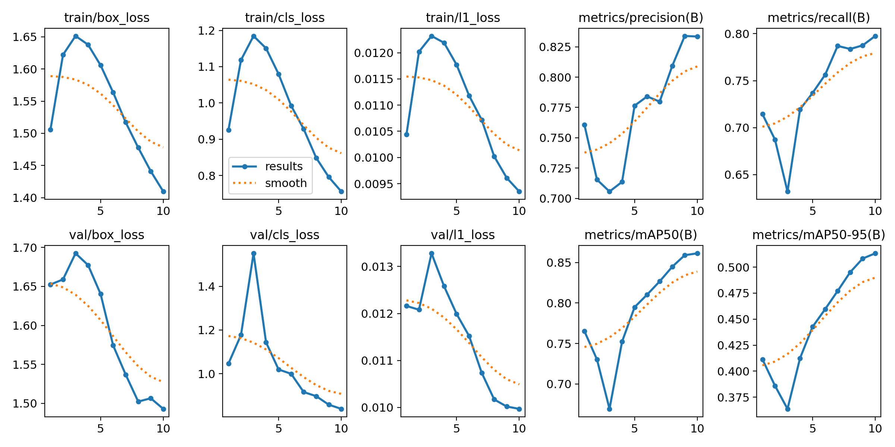
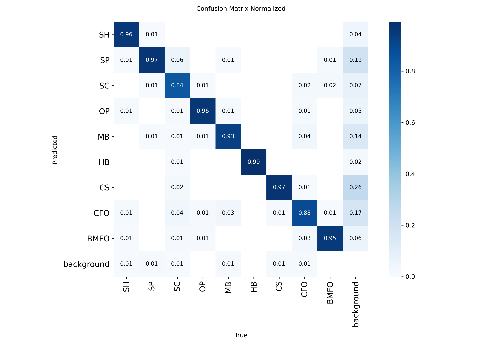
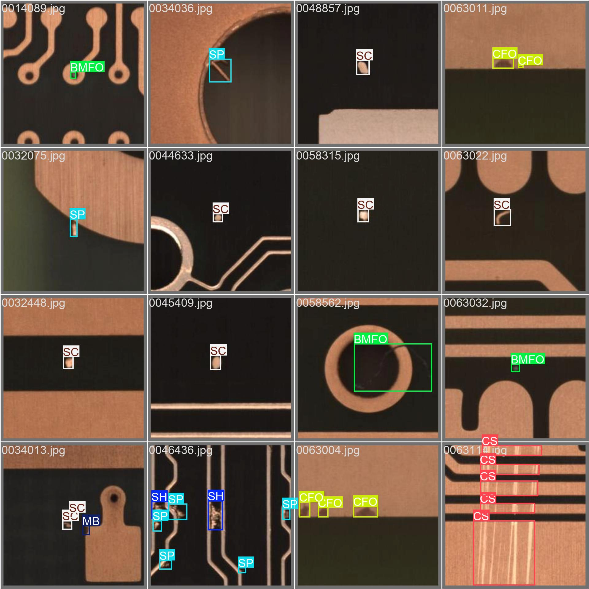
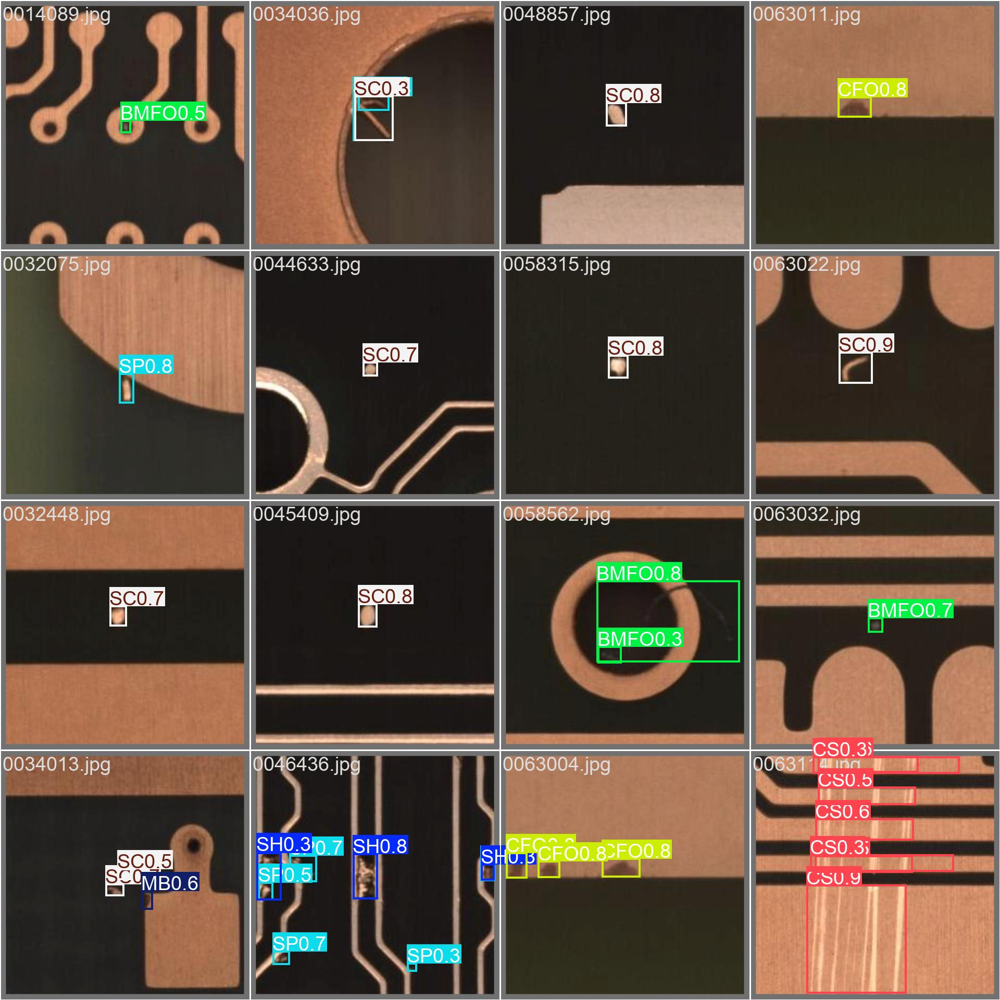

# PCB Defect Detector

**Work in progress.** The model is trained, the app is the next step.

The goal is an app that takes a really high resolution photo of a PCB (like 8K), cuts it into tiles, finds defects in every tile with a YOLO model and draws a red box around each defect on the full image.

## Data

I use the public **DsPCBSD+** dataset (Lv et al., Scientific Data 2024): 10,259 small PCB crops with 20,276 hand drawn boxes over 9 defect types. More details in [Data/README.md](Data/README.md).

| Code | Defect |
|---|---|
| SH | Short |
| SP | Spur |
| SC | Spurious copper |
| OP | Open |
| MB | Mouse bite |
| HB | Hole breakout |
| CS | Conductor scratch |
| CFO | Conductor foreign object |
| BMFO | Base material foreign object |

Things I noticed about the data:

- The images are small and not all the same size (I saw 108 px and 226 px), YOLO scales them up to 640
- Labels are in YOLO format, one line per box: `class x_center y_center width height`, all as fractions of the image size so it works for any image size
- The classes are not balanced, about 5x more spurs than shorts
- A lot of boxes overlap, for example a spur box can sit inside a short box

## Model

I fine tuned **YOLO26m** (Ultralytics, pretrained on COCO). I picked it because it's the newest YOLO you can download right now, it's a bit better than YOLO11m on COCO at the same speed and it has a new label assignment (STAL) that helps with small objects, which defects are.

Detection is basically two tasks at once:

- **Regression**: where is the box (4 numbers)
- **Classification**: which of the 9 defects it is

Training is literally one command since Ultralytics reads the YOLO labels directly:

```python
from ultralytics import YOLO
YOLO("yolo26m.pt").train(data="data.yaml", epochs=10, imgsz=640, workers=4)
```

## Results

Trained on an RTX 3080 (10 GB). 10 epochs took about 40 min.

| Run | Epochs | mAP50 | mAP50-95 | Precision | Recall |
|---|---|---|---|---|---|
| First run | 10 | 0.857 | 0.501 | 0.818 | 0.796 |
| Continued from best.pt | +10 | **0.861** | **0.513** | 0.833 | 0.798 |

Per class after the first 10 epochs:

| Class | mAP50 | mAP50-95 |
|---|---|---|
| HB | 0.979 | 0.799 |
| SH | 0.922 | 0.575 |
| OP | 0.913 | 0.541 |
| BMFO | 0.898 | 0.452 |
| SP | 0.856 | 0.390 |
| MB | 0.843 | 0.407 |
| SC | 0.831 | 0.503 |
| CFO | 0.737 | 0.426 |
| CS | 0.731 | 0.413 |

Inference is about 4 ms per image.

The trained model is in `models/pcb_yolo26m.pt` (the 20 epoch one), so you don't have to retrain to use it:

```python
from ultralytics import YOLO
model = YOLO("models/pcb_yolo26m.pt")
results = model("some_pcb_image.jpg")
```

What I learned from the results:

- The rare classes (SH, BMFO) are not the problem, they actually score well. The hardest ones are **CS** (scratches) and **CFO** (foreign objects on copper) because they look different every time
- **SP** and **MB** get found but their boxes are not precise (high mAP50, low mAP50-95), they are tiny and thin so a few pixels off matters a lot
- Continuing from `best.pt` restarts the learning rate, so the first ~6 epochs were just recovering. It only gained a little in the end, mostly in box precision
- The losses were still going down at epoch 20 so more training should help

### Training curves (continued run)



You can see the dip in the first 3 epochs from the learning rate restarting, after that everything goes the right way and mAP is still climbing at the end.

### Confusion matrix



The classes almost never get mixed up with each other (the diagonal is 0.84 to 0.99). The real problem is the **background** column: when the model draws a box where there is no defect, it's mostly CS (26%), SP (19%), CFO (17%) or MB (14%). So CS and CFO score low because of **false alarms**, not because they get confused with other defects. Missed defects (background row) are only about 1%.

### Labels vs predictions

Real labels:



What the model predicted on the same images:



## How the app will work

1. Load the high res PCB image
2. Cut it into tiles with two grids: grid A starts at the corner, grid B is shifted by the leftover edge (or half a tile if the leftover is too small) so defects cut by grid A are whole in grid B. Tiles that go past the edge get black padding
3. Run the model on every tile
4. Add the tile offset to each box to get full image coordinates
5. Merge duplicate boxes from the two grids with NMS
6. Draw red boxes with the class and confidence
7. Streamlit UI: upload an image, confidence slider, count per defect type

The tricky part is the tile size: defects in the tiles have to look about as big as in the training images, otherwise the model won't find them.

## Test data for the app

To test the app on real full boards I use the **PKU-Market-PCB** dataset (Huang et al., [A PCB Dataset for Defects Detection and Classification](https://arxiv.org/abs/1901.08204)). It's not uploaded here because it's almost 1 GB, download it and put it in `Data_app_test/PKU-Market-PCB/`:

- Official: [Peking University lab page](https://robotics.pkusz.edu.cn/resources/datasetENG/) (Baidu Pan link)
- Easier mirror I used: [RobotHuman/PCB_defect on Hugging Face](https://huggingface.co/datasets/RobotHuman/PCB_defect)

What's in it:

- 693 full board images, around 2300 to 3000 px per side
- 2,953 defects, labels are Pascal VOC xml files with pixel corners (`xmin ymin xmax ymax`), not YOLO format
- 6 defect types, 5 of them are also in my training data (mouse bite, open circuit, short, spur, spurious copper). Missing hole is not, so I skip those images
- The defects were added with Photoshop, so they're not real factory defects, but it's fine for testing the pipeline

A typical defect on these boards is about 64x63 px (from 24 up to 283 px). In the training images a defect takes about 10-30% of the crop, so a tile size of about **256-320 px** should make the defects look the same size as in training. With 640 px tiles they would look about 2x too small.

There is also a 2026 paper that does almost the same thing on this dataset ([Scale-Aware Tile Inference for High-Resolution PCB Defect Detection](https://arxiv.org/abs/2605.24726)). They found a model trained on full images gets mAP50 = 0.01 when run on tiles, so the scale really matters, and that overlapping tiles fix most of the missed defects on tile borders.

## Problems I ran into

- **Out of memory on Windows**: old dataloader workers from crashed runs stayed alive in Jupyter (27 Python processes using 22 GB of RAM). Fixed by restarting the kernel and using `workers=4`
- **Wrong class counts at first**: my counting command skipped the last line of every label file because the files don't end with a newline

## To do

- [ ] Train longer (200 epochs overnight, `patience=20`) in one clean run
- [ ] Try `imgsz=320` since the images are small anyway (much faster)
- [ ] Try class weights (`cls_pw`) and `flipud` augmentation
- [ ] Build the tiling + Streamlit app
- [ ] Test the app on PKU-Market-PCB and compare 256, 320 and 640 px tiles
- [ ] Test on my own PCB photos

## Files

```
PCBD/
├── 01_model_train_eval.ipynb   # training
├── data.yaml                   # dataset config for YOLO
├── Data/                       # DsPCBSD+ dataset, see Data/README.md
├── Data_app_test/              # PKU-Market-PCB full boards (not uploaded), see Data_app_test/README.md
├── models/pcb_yolo26m.pt       # trained model
└── runs/                       # YOLO training plots (weights are not uploaded)
```
