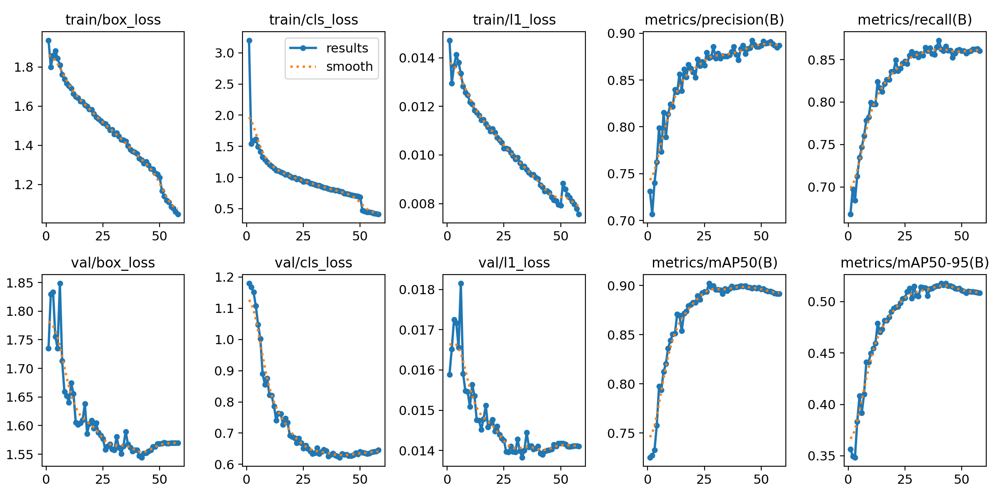
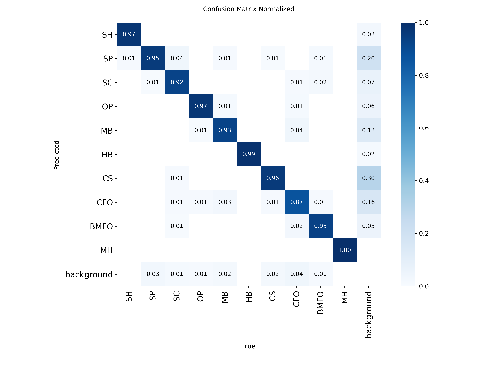
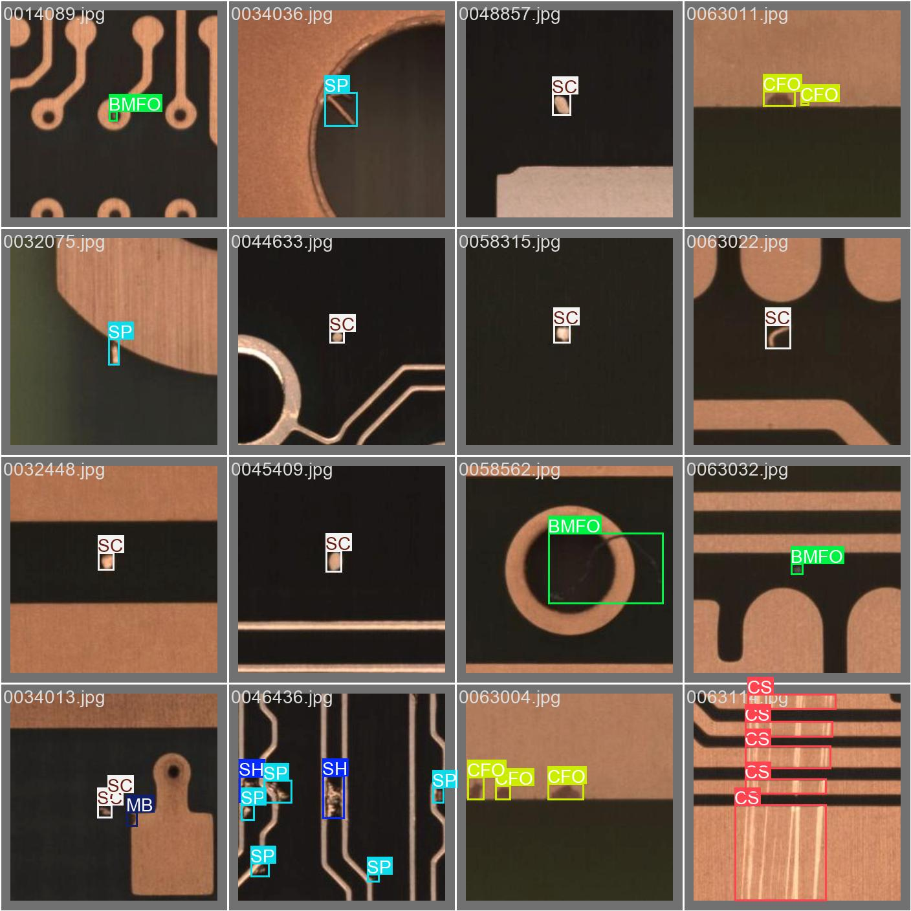
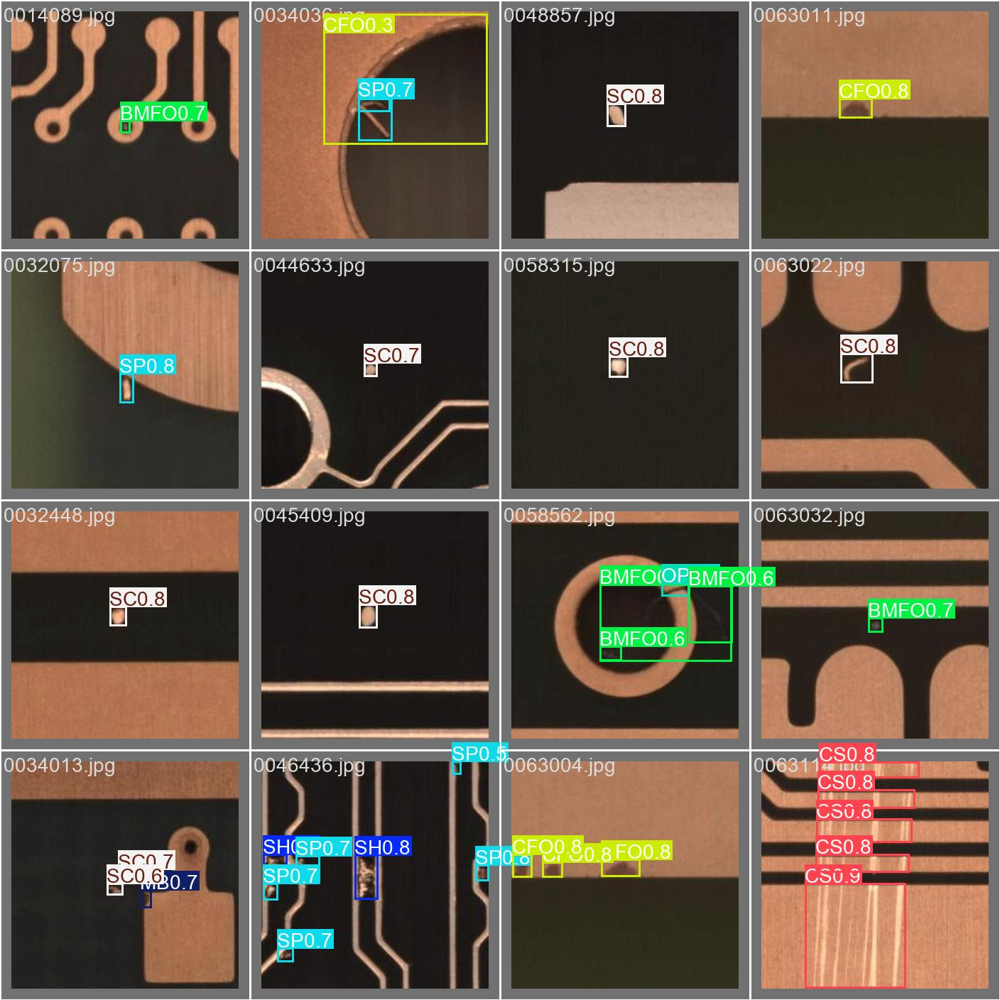

# PCB Defect Detector

**Demo:** [Streamlit app](https://full-projects-fwgz2ytdquksf6mexeldqg.streamlit.app/)

An app that takes a high resolution photo of a full PCB, cuts it into tiles, finds defects in every tile with a YOLO model and draws a red box around each defect on the full image.

## Data

For training I use the public **DsPCBSD+** dataset (Lv et al., Scientific Data 2024): 10,259 small PCB crops with 20,276 hand drawn boxes over 9 defect types. More details in [Data/README.md](Data/README.md). I also add tiles from the PKU-Market-PCB full boards (see [Test data](#test-data-for-the-app)), which brings a 10th class, missing hole.

| Code | Defect |
|---|---|
| SH | Short |
| SP | Spur |
| SC | Spurious copper |
| OP | Open |
| MB | Mouse bite |
| HB | Hole breakout |
| CS | Conductor scratch |
| CFO | Conductor foreign object |
| BMFO | Base material foreign object |
| MH | Missing hole (only in PKU, see below) |

Things I noticed about the data:

- The images are small and not all the same size (I saw 108 px and 226 px), so I train at `imgsz=320`
- Labels are in YOLO format, one line per box: `class x_center y_center width height`, all as fractions of the image size so it works for any image size
- The classes are not balanced, about 5x more spurs than shorts
- A lot of boxes overlap, for example a spur box can sit inside a short box

## Model

I fine tuned **YOLO26l** (Ultralytics, pretrained on COCO). I picked YOLO26 because it's the newest YOLO you can download right now, it's a bit better than YOLO11 on COCO at the same speed and it has a new label assignment (STAL) that helps with small objects, which defects are. I first used the m version, the l version is bigger and scored better.

Detection is basically two tasks at once:

- **Regression**: where is the box (4 numbers)
- **Classification**: which of the 10 defects it is

It's trained on both datasets together ([combined.yaml](combined.yaml)): the DsPCBSD+ crops plus 320 px tiles cut from the PKU boards ([pku_to_yolo.py](pku_to_yolo.py)), so the model sees defects at the same size as in the app. Training is one command ([train.py](train.py)):

```python
from ultralytics import YOLO
YOLO("yolo26l.pt").train(data="combined.yaml", epochs=60, patience=15, imgsz=320, cache="ram", workers=4)
```

## Results

Trained on an RTX 3080 (10 GB). It stopped early at epoch 58 because nothing got better for 15 epochs after the best one (epoch 43), it took about 1h50.

| Run | Data | imgsz | Epochs | mAP50 | mAP50-95 | Precision | Recall |
|---|---|---|---|---|---|---|---|
| YOLO26m (old) | DsPCBSD+ | 640 | 20 | 0.861 | 0.513 | 0.833 | 0.798 |
| **YOLO26l** | DsPCBSD+ and PKU tiles | 320 | 58 (best 43) | **0.900** | **0.518** | 0.880 | 0.865 |

Per class (3,989 val images, 5,956 boxes):

| Class | mAP50 | mAP50-95 |
|---|---|---|
| MH | 0.995 | 0.563 |
| HB | 0.983 | 0.820 |
| SH | 0.961 | 0.490 |
| OP | 0.956 | 0.519 |
| SC | 0.915 | 0.499 |
| MB | 0.908 | 0.467 |
| BMFO | 0.885 | 0.479 |
| SP | 0.883 | 0.423 |
| CS | 0.777 | 0.490 |
| CFO | 0.733 | 0.432 |

Inference is about 2 ms per 320 px image on the GPU and about 0.24 s on a CPU.

The trained model is in `models/pcb_yolo26l_320.pt`, so you don't have to retrain to use it:

```python
from ultralytics import YOLO
model = YOLO("models/pcb_yolo26l_320.pt")
results = model("some_pcb_image.jpg")
```

What I learned from the results:

- The rare classes (SH, BMFO) are not the problem, they score well. The hardest ones are still **CS** (scratches) and **CFO** (foreign objects on copper) because they look different every time
- **SP** and **MB** get found but their boxes are not precise (high mAP50, low mAP50-95), they are tiny and thin so a few pixels off matters a lot
- Going to 320 px and the bigger l model helped mostly recall (0.798 to 0.865)
- One clean run is better than continuing from `best.pt`, continuing restarts the learning rate and the first epochs are just recovering

### Training curves



### Confusion matrix



The classes almost never get mixed up with each other (the diagonal is 0.87 to 1.00). The real problem is still the **background** column: when the model draws a box where there is no defect, it's mostly CS (30%), SP (20%), CFO (16%) or MB (13%). So CS and CFO score low because of **false alarms**, not because they get confused with other defects. Missed defects (background row) are only 1 to 4%.

### Labels vs predictions

Real labels:



What the model predicted on the same images:



## How the app works

Run it with `streamlit run app.py` ([app.py](app.py)):

1. Upload a PCB image or pick one of the example boards, then pick a confidence with the slider
2. Convert it to BGR, YOLO wants the colors like cv2 and not RGB (with RGB it found 7 boxes instead of 105 on 40 DsPCBSD+ images)
3. Go over the image tile by tile: 320 px tiles that overlap by 64 px. Small images (like the 226 px DsPCBSD+ crops) are just one tile
4. Run the model on the tile and add the tile offset (x, y) to each box to get full image coordinates
5. The overlap is cut in the middle: a tile only keeps the boxes whose center is in its own half, the neighbour tile keeps the rest. So a defect seen by 2 tiles is drawn once, without saving any boxes
6. Draw a red box with the class and confidence right away, and count per defect type
7. A progress bar shows which tile it's on, since a full board is about 80 to 100 tiles

The tricky part is the tile size: defects in the tiles have to look about as big as in the training images, otherwise the model won't find them. Without tiling the model found 0 defects on the PKU boards, with tiling it finds all of them.

The online demo runs on a CPU only, so a full board takes about a minute there.

### Try it yourself

You don't need to download anything to try it, the [demo](https://full-projects-fwgz2ytdquksf6mexeldqg.streamlit.app/) has 6 full PKU boards in [examples/](examples/), one for every defect type. They are from board 11 and 12, which I kept out of training, so the model never saw them. Just pick one in the dropdown.

On these 6 boards (conf 0.25) it finds all 30 labelled defects. It also draws a few extra boxes: the same 2 spots on every board 12 image, and a couple of defects get 2 boxes when they sit on a tile border.

## Test data for the app

To test the app on real full boards I use the **PKU-Market-PCB** dataset (Huang et al., [A PCB Dataset for Defects Detection and Classification](https://arxiv.org/abs/1901.08204)). It's not uploaded here because it's almost 1 GB, download it and put it in `Data_app_test/PKU-Market-PCB/`:

- Official: [Peking University lab page](https://robotics.pkusz.edu.cn/resources/datasetENG/) (Baidu Pan link)
- Easier mirror I used: [RobotHuman/PCB_defect on Hugging Face](https://huggingface.co/datasets/RobotHuman/PCB_defect)

What's in it:

- 693 full board images, around 2300 to 3000 px per side
- 2,953 defects, labels are Pascal VOC xml files with pixel corners (`xmin ymin xmax ymax`), not YOLO format
- 6 defect types, 5 of them are also in DsPCBSD+ (mouse bite, open circuit, short, spur, spurious copper). Missing hole is not, so it's a new class (MH) that only comes from PKU
- The defects were added with Photoshop, so they're not real factory defects, but it's fine for testing the pipeline

A typical defect on these boards is about 64x63 px (from 24 up to 283 px). In the training images a defect takes about 10-30% of the crop, so I use **320 px** tiles to make the defects look the same size as in training. With 640 px tiles they would look about 2x too small.

There is also a 2026 paper that does almost the same thing on this dataset ([Scale-Aware Tile Inference for High-Resolution PCB Defect Detection](https://arxiv.org/abs/2605.24726)). They found a model trained on full images gets mAP50 = 0.01 when run on tiles, so the scale really matters, and that overlapping tiles fix most of the missed defects on tile borders.

## Problems I ran into

- **Out of memory on Windows**: old dataloader workers from crashed runs stayed alive in Jupyter (27 Python processes using 22 GB of RAM). Fixed by restarting the kernel and using `workers=4`
- **Wrong class counts at first**: my counting command skipped the last line of every label file because the files don't end with a newline
- **App found almost nothing on DsPCBSD+ images**: I gave YOLO the image as RGB from PIL, but it wants BGR like cv2. Converting with `cv2.cvtColor` fixed it
- **Streamlit Cloud couldn't import cv2**: ultralytics installs the normal `opencv-python`, which needs `libGL` on Linux. Fixed with a `packages.txt` in the repo root (`libgl1`, `libglib2.0-0`) and the cpu version of torch in `requirements.txt`

## Files

```
PCBD/
├── app.py                      # Streamlit app with tiling
├── requirements.txt            # packages for the app (Streamlit Cloud)
├── examples/                   # 6 full PKU boards to try in the app
├── train.py                    # training
├── combined.yaml               # dataset config for YOLO (DsPCBSD+ and PKU tiles)
├── pku_to_yolo.py              # cuts the PKU boards into 320 px tiles with YOLO labels
├── Data/                       # DsPCBSD+ dataset, see Data/README.md
├── Data_app_test/              # PKU-Market-PCB full boards and tiles (not uploaded), see Data_app_test/README.md
├── models/pcb_yolo26l_320.pt   # trained model
└── runs/                       # YOLO training plots (weights are not uploaded)
```
