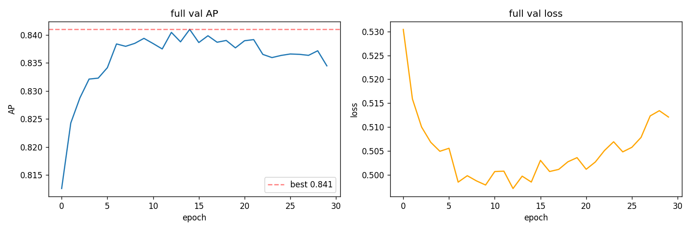
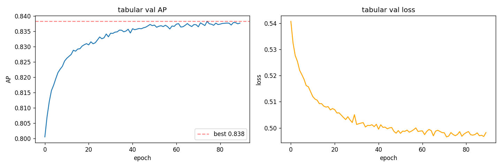
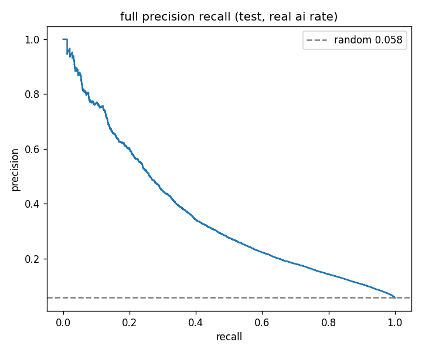
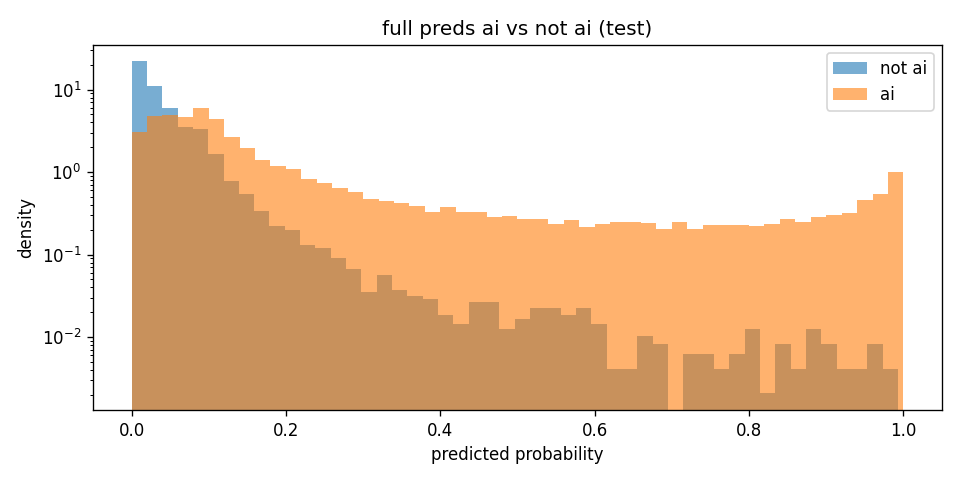
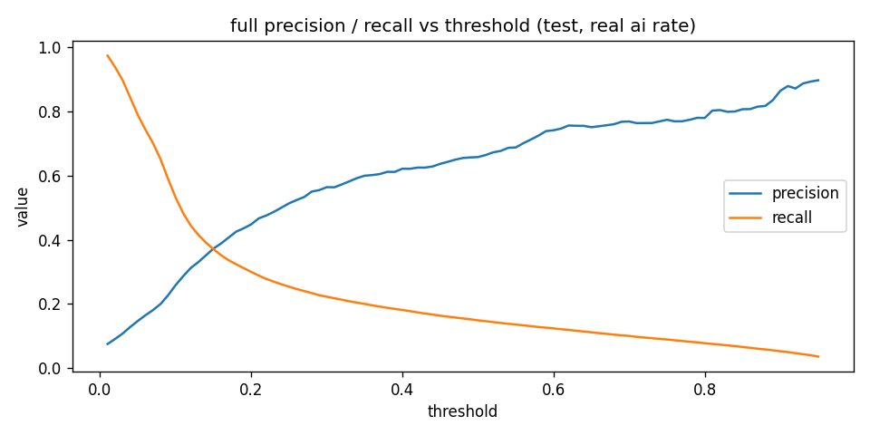

# TikTok AI Content Detector

So the question I wanted to answer was: can you tell a TikTok post is AI-generated without actually watching it? Just from the boring stuff like duration, resolution, views, sound, hashtags and the caption.

I trained a neural network on that metadata to predict TikTok's own `is_ai_generated` tag, then checked how it does at the real AI rate, which is only about 5.8% of posts.

Short answer: kind of. When the model is really sure it's usually right (at a 0.9 cut-off, 86.5% of the posts it flags are AI, against 5.8% if you guess randomly). But metadata can't catch everything, so in the end I used it as a filter that sends the unsure posts to a human instead of a plain yes/no classifier.

## What I did

- Took a balanced 500k sample out of a huge public TikTok dataset and cleaned it
- Added some features of my own and turned captions into vectors with Qwen3-Embedding-0.6B
- Trained two MLPs, one on the tabular features only and one with the caption embeddings added
- Fixed the probabilities so they match the real AI rate and not the 50/50 training mix
- Picked thresholds for a three-way setup: auto flag, human review, or pass

## Dataset

The data is from [datasocial/tiktok-5.6B-videos](https://huggingface.co/datasets/datasocial/tiktok-5.6B-videos) on Hugging Face. I only used September 2026 and that alone is about 99 million posts (11 GB), so yeah, one month was enough. The columns are explained in [Data/README.md](Data/README.md).

In that month:
- about 3.4M posts are tagged as AI
- about 55.5M are tagged as not AI
- about 39.7M have no tag at all (TikTok just didn't say), so I can't train on those

Only around 5.8% of the tagged posts are AI. If you train on that directly the model gets lazy and just says "not AI" all the time, so the cleaning notebook picks 250k AI and 250k not-AI posts at random from the whole month. That's `sample_500k.parquet`. It also saves a separate 200k sample at the natural rate (`test_natural_200k.parquet`), which the training notebook doesn't use right now.

The dataset is CC BY-NC 4.0, so this is a learning project, not something you can use commercially.

## Project Structure

```
Tiktok/
├── 00_data_understanding_cleaning.ipynb   # sampling, cleaning, features, caption embeddings
├── 01_model_train_eval.ipynb              # training, evaluation, thresholds
├── Data/
│   ├── README.md                          # notes on the raw data
│   ├── 2026-09.parquet                    # the full September slice (11 GB)
│   ├── sample_500k.parquet                # balanced 50/50 sample
│   ├── test_natural_200k.parquet          # natural-rate sample (not used yet)
│   ├── Processed.parquet                  # cleaned features, output of notebook 00
│   └── caption_emb_512.npy                # caption embeddings, same row order
├── models/
│   ├── best_tabular.pth                   # tabular features only
│   ├── best_full.pth                      # tabular + caption embeddings (the one used)
│   └── scaler.pkl                         # StandardScaler fitted on the train split
├── labels/
│   ├── feature_columns.csv                # tabular feature names, in order
│   ├── log_columns.csv                    # columns that get log1p before scaling
│   ├── labels_ai.csv                      # target name
│   └── thresholds.json                    # prior shift + the chosen thresholds
├── plots/                                 # training curves and evaluation plots
└── README.md
```

The parquet and npy files are too big for git, so they're ignored. You get them back by running the cleaning notebook.

## What the model looks at

After cleaning there are 33 features per post:

- **The post itself**: duration, image count, width, height, photo or video, ad / shop / branded flags, muted sound, hidden from For You
- **Engagement**: views, likes, comments, shares, saves, downloads, engagement rate, and how long after posting the stats were taken
- **Text**: language and country frequency, number of hashtags, mentions, on-screen text length, caption length, share of capital letters, number of emojis
- **Repeats**: how often the exact duration, resolution, sound and hashtags show up in the sample
- **Format details**: the milliseconds part of the duration, aspect ratio
- **Sound age**: TikTok IDs have a timestamp in their first 32 bits, so `video_id - sound_id` tells you how old the sound was when the post went up (about 0 means the creator made it)

The full model also gets the 512-number caption embedding on top.

The "repeats" and "format" features came from stuff I noticed while digging through the data:

- **Exact durations give AI away.** Video generators export fixed lengths. A video that's exactly 10,008 ms long is AI 95% of the time, and 12,052 ms is 99%. Real phone videos are whatever length you stopped recording at.
- **Some resolutions too.** 496×864 is 99.6% AI.
- **Hashtags** like `#aicast`, `#aicreate`, `#aivideo` and `#chatgpt` are close to 100% AI. Not surprising. `#moras` (98.5%) and `#fruitstory` (100%) were though.
- **Photo posts** are AI more often than videos (68% vs 46% in the balanced sample).

## Getting Started

Install the packages:

```bash
pip install pandas numpy pyarrow torch torchmetrics scikit-learn sentence-transformers lingua-language-detector matplotlib joblib jupyter
```

Then run the notebooks in this order:

1. `00_data_understanding_cleaning.ipynb`: the sampling cell reads the full 11 GB file once to build the samples. The caption embedding cell takes about 45 minutes on an RTX 3080 the first time, then loads from `Data/caption_emb_512.npy`.
2. `01_model_train_eval.ipynb`: trains both models (10 to 15 minutes on an RTX 3080), saves the plots and picks the thresholds.

## Model Architecture

Both models are the same MLP:

- Input: 33 tabular features (tabular model), or 33 + 512 caption embedding dims (full model)
- Log1p on the heavy-tailed counts, then StandardScaler fitted on the train split only
- 3 hidden layers (1024 → 512 → 256), ReLU and dropout 0.5
- 1 output logit, BCEWithLogitsLoss
- AdamW (lr 1e-3, weight decay 1e-2), batch size 2048
- Early stopping on validation average precision (patience 15), best checkpoint is saved

**The split.** It's 80/10/10, but about 22% of captions show up more than once (reposts, templates, spam). With a normal random split the same caption ends up in train and test and the model just memorizes it, which makes the score look better than it is. The cleaning drops the caption text, but identical captions have identical embeddings, so I grouped posts by their embedding and kept each group on one side. No caption appears in both train and test.

**Fixing the probabilities.** The model trains on 50/50, so it thinks AI posts are super common. Before evaluating I add `log(0.058 / 0.942) - log(0.5 / 0.5)` (about -2.8) to every logit. After that a prediction of 0.7 actually means "about 70% likely AI" on real data.

**Testing at the real rate.** The test split is 50/50 too, so I reweighted every metric below: each AI post counts as 0.115 posts and each normal post as 1.885, which makes it behave like real data at 5.8% AI. In an earlier experiment I compared this with the separate natural-rate sample and they were within about 0.003 average precision of each other, so I trust it.

## Results

All numbers are on the held-out test split (about 48k posts), reweighted to the real 5.8% AI rate:

| Model | ROC-AUC | Average precision | Best epoch |
|---|---|---|---|
| Tabular + caption embeddings | **0.841** | **0.359** | 14 |
| Tabular only | 0.839 | 0.356 | 74 |
| Random guessing | 0.5 | 0.058 | - |

Honestly the two are basically the same. Captions help a tiny bit, but the model also starts overfitting way earlier with them. The full model peaks at epoch 14 and the validation loss goes up after that, while the tabular one keeps slowly getting better until epoch 74:




If you look at the plain 50/50 test split the average precision is 0.84, and I'll admit that number got me excited at first. But it's inflated by the balanced mix. 0.359 is what you'd actually get on TikTok, which is still about 6 times better than guessing.

Here's the precision-recall curve. On the left side, where the model is really sure, precision stays above 75% until it has caught about 10% of the AI posts, then it slowly drops:



And this is how the predictions are spread out. Most normal posts sit near 0, AI posts are all over the place. The orange part on the left that overlaps with the normal posts is the AI the model just can't tell apart from metadata:



### Picking a threshold

There's no single best threshold. It depends on how bad a wrong flag is for you:

| Threshold | Precision | Recall | Posts flagged |
|---|---|---|---|
| 0.05 | 14.7% | 78.9% | 30.4% |
| 0.10 | 25.9% | 53.2% | 11.6% |
| 0.15 | 37.3% | 37.1% | 5.6% |
| 0.20 | 44.8% | 30.0% | 3.8% |
| 0.30 | 56.4% | 22.3% | 2.2% |
| 0.50 | 65.8% | 14.9% | 1.3% |
| 0.70 | 76.9% | 10.0% | 0.7% |
| 0.90 | 86.5% | 5.3% | 0.3% |



### Human review setup

The model is only confident about a small part of the AI posts, so I went with two cut-offs instead of one:

- **Score ≥ 0.79**: flagged as AI automatically
- **0.069 to 0.79**: a person checks it
- **Below 0.069**: passes

I picked the cut-offs on the validation split (going for 85% precision on auto flags and 70% of AI caught in total) and then checked them on the test split:

| | Share of posts | Actually AI | Share of all AI caught |
|---|---|---|---|
| Auto flag | 0.6% | 78.1% | 8.0% |
| Human review | 21.7% | 16.3% | 62.6% |
| Pass | 77.7% | - | 29.4% missed |
| **Total** | | | **70.6%** |

The 70% goal holds up on test. The auto flags came out a bit under the 85% target (78%), but only a few hundred test posts score that high, so that number is noisy. A reviewer would end up looking at about 1 in 5 posts, and roughly 1 in 6 of those would be AI. If they picked posts at random it would be 1 in 17. The thresholds are saved in `labels/thresholds.json`.

## Things I'd do differently / limitations

- **The model only uses metadata, it never sees the video.** If something is AI-made, it mostly shows in the pixels and the audio, and that's exactly what I don't have. Even one frame per post (basically the thumbnail) run through an image model would probably boost it a lot, more than all my metadata features together. This dataset has no media though, so that would need a separate download step.
- **The human review could make it better over time.** Every post a reviewer checks gets a real, checked label, and those are exactly the posts the model wasn't sure about. Feeding them back into training would give it more (and cleaner) data right where it struggles, so it should get more precise every round.
- **The labels are noisy.** `is_ai_generated` is TikTok's own tag and lots of AI posts never get tagged. So some of my "false alarms" are probably real AI posts, which makes the precision look worse than it really is.
- **Label-based features would help.** In an earlier experiment I added target encodings (stuff like "how often is this exact duration AI in the training data", computed out-of-fold) and a TF-IDF text score, and average precision went from about 0.36 to about 0.46. I left them out here because they need labels and a fixed split, so they don't really belong in a cleaning notebook.
- **It's one month.** Everything is from September 2026 and AI tools change fast, so the thresholds would need checking again on newer data.
- **I haven't used the natural-rate sample yet.** Running the same cleaning on `test_natural_200k.parquet` (with the frequencies and counts taken from the training sample) would give a real test instead of a reweighted one. That's the next thing on my list.

## License

The data is from [datasocial/tiktok-5.6B-videos](https://huggingface.co/datasets/datasocial/tiktok-5.6B-videos), released under CC BY-NC 4.0 (research and personal use only).
